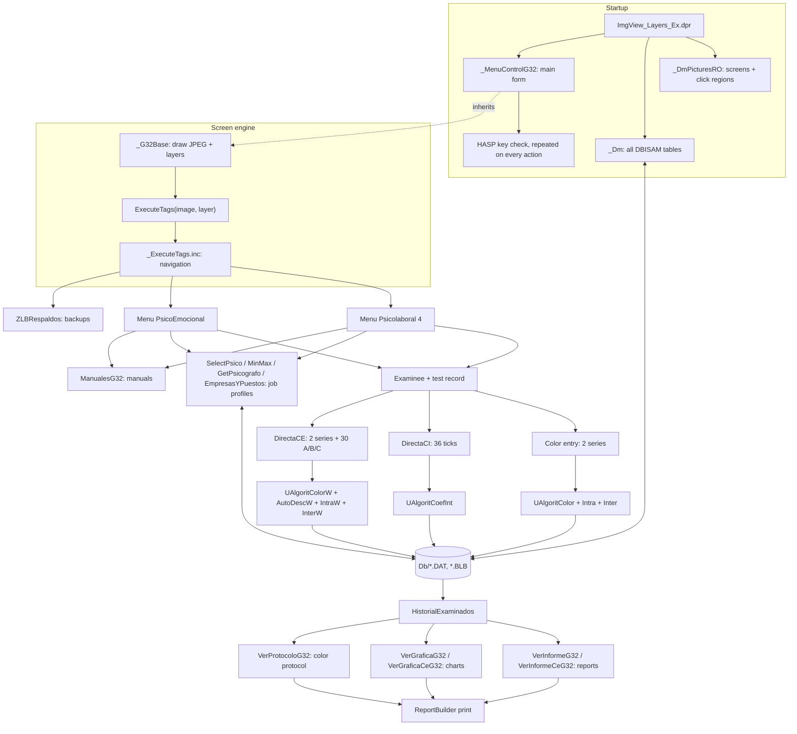
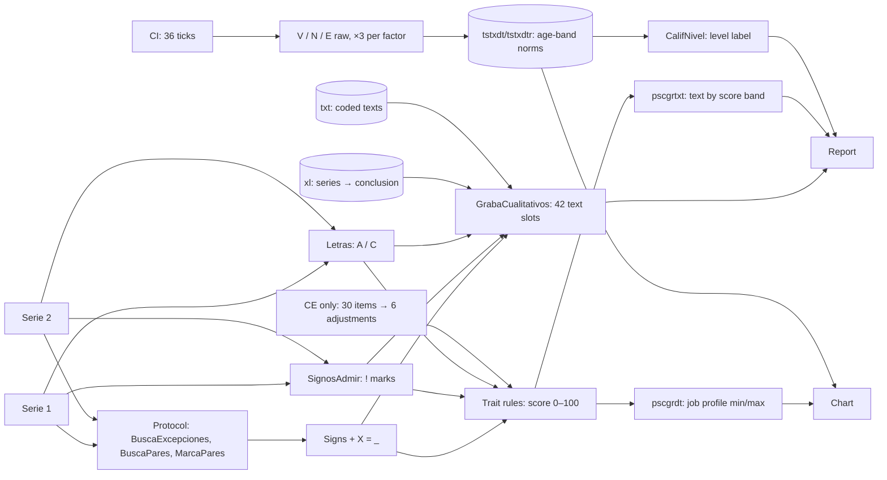
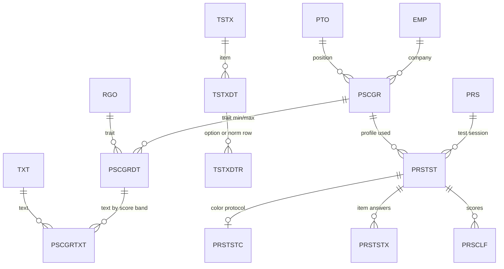

# PsIV legacy architecture

How the existing Delphi application is structured and wired. Read this before working from [MIGRATION_PLAN.md](MIGRATION_PLAN.md).

PsIV ("Psicolaboral 4" and "PsicoEmocional") is a 2006–2007 Windows desktop app. It scores three instruments and produces reports with charts. It depends on DBISAM tables, a HASP USB key, Graphics32 and paid VCL components (RichView, TeeChart, ReportBuilder).

## Which source is current

| Location | What it is | Use it for |
|---|---|---|
| Root `*.pas`, `*.inc` | Newest code (up to June 2007), but no `.dfm` or `.dpr` | **Logic** |
| `AGB_Layers_Ex/` | Project file, forms and older code (Sept 2006) | **Layouts** (`*.dfm`) and the unit list |
| `Codigo/PsIV/` | Mostly a copy of the two above | Nothing extra |
| `Codigo/PsIII/` | Older standalone apps: PIII, CE, Polimpact (authoring tool), ChipPIII, ZUtilPIII | Reference only |
| `Db/` | The database, including examinee records | See [DATA_EXTRACTION.md](DATA_EXTRACTION.md) |
| `Graficos/`, `Botones*/` | Art and screenshots. `Graficos/_ScreenCaptureP4` and `_ScreenCaptureCE` are useful references | Comparing results |
| `docs/` | Book and the original test documents | Methodology |

- The entry point is `AGB_Layers_Ex/ImgView_Layers_Ex.dpr` (title "Psicolaboral 4"). "Layers Ex" is the name of the Graphics32 sample it grew from.
- `_MenuControlG32.pas` exists only at root, and that `.dpr` doesn't reference it, so the final project file is missing.
- `P4_Durango.exe` (Dec 2008) contains source file names, so it may be a later archive. Inspect it without running it.
- Sources are Windows Latin-1, not UTF-8.

## The three instruments

The app is **operator data entry**: someone transcribes results from paper sheets and colour cards. Examinees never use it.

| Instrument | Input | Engine | Output |
|---|---|---|---|
| **Colores** (abbreviated Lüscher) | 2 series, each a permutation of the digits 0–7 | `UAlgoritColor` (protocol + 42 qualitative slots), `UAlgoritColorIntra`, `UAlgoritColorInter` | Signs `+ X = _`, `!` marks, A/C letters, trait scores, report texts |
| **CI** | 36 right/wrong ticks, 12 each for Verbal, Numeric, Spatial | `UAlgoritCoefInt` | Raw score → age-band norm table (18–30, 31–45, 46+) → CI and level label |
| **CE** | Color series + 30 A/B/C Autodescriptive items | `UAlgoritColorW`, `UAlgoritAutoDescW`, `UAlgoritColorIntraW`, `UAlgoritColorInterW` | 6 intra + 6 inter traits, C.E. Intra/Inter, Factor G Emocional |

The modules combine them: **Psicolaboral 4** offers Colores and CI, and **PsicoEmocional** offers CE.

## System wiring

Navigation is data rather than code. Screens are JPEGs stored in the database (`MDgr`) with clickable regions (`MDgrL`). A click calls `ExecuteTags(imageTag, layerTag)`, a large `case` in `_ExecuteTags.inc`.

## Scoring pipeline

Only Serie 2 drives traits and qualitative texts. Serie 1 feeds the protocol and the evolution comparisons. The qualitative texts belong to the P4 path; CE scores traits only.

**How text selection works.** The engine asks for a code such as `CC01`. `GetTexto` (`UAlgoritColor.pas:1156`) looks for variants `CC01A`, `CC01B` and so on in `txt`, then picks one at random. The chosen ID is stored on the session, so a saved report stays stable, but rescoring the same answers can produce different wording.

**Report order:** header, I. CI profile, Color qualitative texts, `III` trait scores with texts, labour prognosis, `IV` emotional intelligence, conclusions.

**Chart:** three series per trait: Mínimo and Máximo from the job profile ("psicógrafo"), and Examen from the session (`VerGraficaG32.pas:316`, `:351`). See `GraficaSnagit.png`. The 3D look is legacy styling and doesn't carry meaning.

## Data model

CE has parallel `W` tables (`rgow`, `pscgrdtW`, `pscgrtxtW`, `txtW`, `tstxW`, `tstxdtW`, `tstxdtrW`). `xl` is a lookup table and `txtm` holds the P4 manuals. Table bindings are in `AGB_Layers_Ex/_Dm.dfm`.

## Standardization: what the sources show

**The book doesn't describe a French study.** Tibaldi wrote it in Guadalajara, Mexico, in 2000, adapting the Lüscher test (from Max Lüscher) to the Latin American workplace. France appears only incidentally, for example a 1957 colour conference in Amiens. The project treats the Lüscher study as the general "Europe" reference.

The only European data is one appendix table (PDF p. 99–100, book p. 217–219), taken from Lüscher and Ian A. Scott:

It gives first-choice percentages and a color order for México and Europa. The values aren't repeated here: read them from the book, which stays outside this repo.

- The book reports r = +0.70 between the two columns.
- The appendix note gives a Mexican sample of 5,000 adults, while the introduction says more than 4,000.
- These figures come from OCR. Each column sums to 100 and matches the printed order, but re-check them against the page image before using them.

**Color scoring is rule-based and never reads population norms.** So today's "LatAm standardization" really consists of:

- the CI norm tables
- the Spanish report texts
- the Mexican interpretive notes in the book, such as Azul in 5th–6th place not being significant at work (book p. 97)

There's no European CI or CE data in this repository. Phase 9 of the [migration plan](MIGRATION_PLAN.md) covers what a Europe profile can and can't change.
