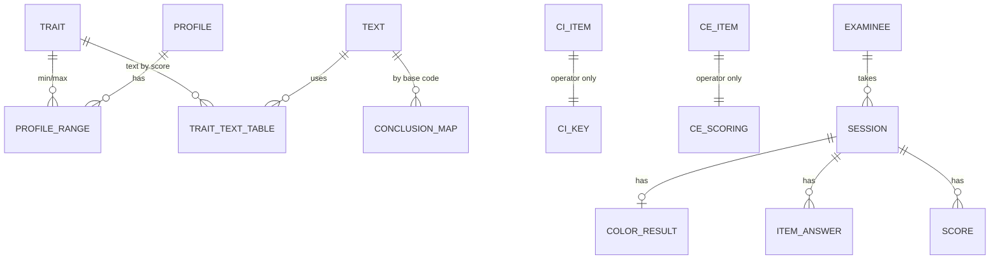

# PsIV new data model

The target data structure for the React app, and what the extraction found that later phases need. It builds on [DATA_EXTRACTION.md](DATA_EXTRACTION.md) and is implemented from Phase 4 of [MIGRATION_PLAN.md](MIGRATION_PLAN.md).

**This file is safe to commit.** It has structure and aggregate counts only. Never add answer keys, norm values, report texts, test items or examinee data here. Examples use made-up values.

**Status: partly implemented.** The scoring engines, content packs, local database, operator capture, results, profiles, manuals and norm profiles (Phases 2 to 9) are built. The [oracle](#legacy-oracle-new-finding) has been run against the engines. Anything for later phases is still a proposal. Items marked "needs a decision" aren't settled.

## Start here

| Phase | What to take from this file |
|---|---|
| 1 | [Forbidden files and setup notes](#phase-1) |
| 2 | Test against the [legacy oracle](#legacy-oracle-new-finding): 174 real input pairs with legacy outputs |
| 3 | Return [stable IDs and base text codes](#stable-ids), and use the [scoring facts](#phase-3) |
| 4 | Build the [content pack](#content-pack), using the [mapping](#legacy-to-new-mapping) and [build checks](#build-pack-checks) |
| 5 | Build the [local database](#local-database) |

## Principles

1. **Content and user data are separate.** Packs are read-only and versioned. IndexedDB holds only what users create.
2. **IDs are never reused and always carry a namespace.** Legacy reuse is why old person records can't be trusted (see [findings](#what-the-legacy-data-teaches)).
3. **A session is a permanent record.** It stores its own profile ranges, chosen texts and versions, so later edits can't change an old report.
4. **Scoring is a pure function.** Random text choice is seeded and stored, and content tables are never written to.
5. **The examinee pack leaks nothing that scores.** No keys, points, factors, norms or report texts.

## Stable IDs

| Entity | Format | Example | Why |
|---|---|---|---|
| Trait | `p4:<legacy id>`, `ce:<legacy id>` | `p4:18` | `rgo` and `rgow` share 14 numeric IDs for different traits |
| Text | `p4:<legacy id>`, `ce:<legacy id>` | `ce:45` | `txt` and `txtW` overlap on 1 ID |
| Test item | `ci:<1–36>`, `ce:<1–30>` | `ci:21` | Number printed on the question. CI `ORDEN` is 0-based, CE is 1-based |
| Factory profile | `factory:<legacy id>` | `factory:6` | Same profile ID serves both P4 and CE |
| Custom profile, examinee, session | UUID | | Created by the app |

`~/psiv-private/export/corrected/trait-ids.json` maps the 29 names in `GetRasgo` calls to the legacy trait table and ID: 14 in `rgo` and 15 in `rgow`. It leaves out the 4 CI traits, which legacy finds by `ORDEN`, so build-pack should add them from `rgo`. Phase 3 should use trait ID constants, not names.

## Overview



`PROFILE` to `SESSION` isn't a live link, because the session keeps a snapshot.

## Content pack

The operator pack is split so reports don't have to load the manuals:

| File | Contents | Approx. input size |
|---|---|---|
| `core` | Everything below except manuals, with CI images as PNG | About 1 MB of images, plus JSON |
| `manuals` | Manuals and their images, loaded on demand | 19.5 MB of BMP before PNG conversion |

```ts
interface OperatorPack {
  kind: 'operator-core';
  schemaVersion: 1;
  contentVersion: string;              // recorded on each session
  traits: Trait[];
  reportSections: ReportSection[];     // see "needs a decision" below
  texts: ReportText[];
  traitTextTables: TraitTextTable[];
  conclusions: ConclusionMap;
  ci: { items: CiItem[]; key: CiKey[]; norms: CiNorms };
  ce: { items: CeItem[]; scoring: CeScoring[] };
  profiles: Profile[];
  assets: Record<string, string>;      // path -> base64 PNG
}

interface Trait {
  id: string;                          // 'p4:18'
  module: 'p4' | 'ce';
  name: string;                        // corrected display name, for example the accent
  reportCode: string;                  // legacy ORDEN: '0.2', 'III.3.6', 'IV.1', '1.1', '2.3', '3'
  order: number;
}

interface ReportText {
  id: string;                          // 'p4:125'
  module: 'p4' | 'ce';
  code: string;                        // full legacy code: 'CC01A', 'AD1'
  baseCode: string;                    // 'CC01': what the engine asks for
  variant: string | null;              // 'A', or null when the code has no letter
  html: string;                        // tags allowed: p, strong, em, u, img
  note: string | null;                 // legacy COMENT, for editors only
}

// Which texts apply to a trait at a given score. Bands are inclusive and may overlap:
// collect the texts from every band containing the score.
interface TraitTextTable {
  traitId: string;
  profileIds: string[] | null;         // null = all profiles
  bands: { min: number; max: number; textIds: string[] }[];
}

// 40,320 orderings of Serie 2. Stored as the most common code plus exceptions.
interface ConclusionMap {
  defaultCode: string;
  exceptions: Record<string, string>;  // { '01234567': 'CMxx' }
}

interface CiItem {
  id: string;                          // 'ci:21'
  order: number;
  imageAsset: string;
  answer: { kind: 'choice'; options: string[] } | { kind: 'number' };
}

interface CiKey {
  itemId: string;
  answer: string;
  factor: 'verbal' | 'numeric' | 'spatial';
}

interface CiNorms {
  bands: { id: string; minAge: number; maxAge: number }[];  // 18–30, 31–45, 46–150
  table: Record<string, number[]>;     // band id -> score by raw value, index 0–36
}

interface CeItem {
  id: string;                          // 'ce:1'
  order: number;
  stem: string;
  options: { key: 'A' | 'B' | 'C'; text: string }[];
}

interface CeScoring {
  itemId: string;
  traitId: string;
  points: { A: number; B: number; C: number };
}

interface Profile {
  id: string;                          // 'factory:6' or a UUID
  name: string;                        // from the legacy position
  locked: boolean;                     // BLOQUEADO: factory profiles open read-only
  hasRanges: boolean;                  // false for <NINGUNO>: hide Mínimo and Máximo on the chart
  modules: ('p4' | 'ce')[];
  ranges: Record<string, { min: number; max: number }>;  // trait ID -> range
}
```

`src/content/schemas.ts` is the source of truth for these types. Every object in it is strict, so an unknown field fails.

**File format:** magic bytes `PSIVPACK`, a 4-byte header length, a JSON header, then AES-256-GCM over gzipped JSON. The key comes from PBKDF2-SHA256 with 600,000 iterations, and the header is authenticated.

**Examinee pack:** `ci.items` with their images, `ce.items`, instructions and consent text. It has no `key`, `scoring`, `norms`, `texts`, `traits` or `profiles`. `CiItem` and `CeItem` carry no factor for this reason.

**Demo pack:** same schema with synthetic content, safe to commit.

## Local database

Dexie, version 1. All tables are created by the app, and none are imported from legacy.

```ts
const stores = {
  examinees:      'id, [paternalSurname+maternalSurname+givenName], updatedAt',
  sessions:       'id, examineeId, testDate',
  colorResults:   'sessionId',
  itemAnswers:    '[sessionId+itemId], sessionId',
  scores:         '[sessionId+traitId], sessionId',
  customProfiles: 'id',
  appMeta:        'key',
  invitations:    'id',                // Phase 10
};

interface Examinee {
  id: string;
  givenName: string;
  paternalSurname: string;
  maternalSurname: string;
  sex: 'M' | 'F';                      // legacy form offers MASCULINO and FEMENINO
  birthDate: string;                   // ISO date, validated
  createdAt: string;
  updatedAt: string;
}

interface Session {
  id: string;
  examineeId: string;
  testDate: string;
  ageAtTest: number;                   // frozen: selects CI norms and appears on the report
  maritalStatus: string | null;
  instruments: { color: boolean; ci: boolean; ce: boolean };
  profile: {                           // a snapshot, not a live link
    id: string;
    name: string;
    hasRanges: boolean;
    ranges: Record<string, { min: number; max: number }>;
  };
  contentVersion: string;
  engineVersion: string;
  normProfileId: string;               // Phase 9
  administration: 'paper' | 'screen';  // Phase 10 label
  textSeed: string;                    // makes rescoring reproducible
}

// `customProfiles` adds three fields to `Profile`: company, position and textProfileId.
// `Session.profile.textProfileId` is set for a custom profile. See the Phase 8 notes.

interface ColorResult {
  sessionId: string;
  serie1: string;                      // permutation of 0–7
  serie2: string;
  protocol: {
    serie1: { signs: string; marks: string; letters: string };
    serie2: { signs: string; marks: string; letters: string };
  };
  qualitative: { slot: number; baseCode: string; textId: string }[];
}

interface ItemAnswer {
  sessionId: string;
  itemId: string;
  given: string | null;                // null when the operator only ticked right or wrong
  correct: boolean | null;             // CI
  points: number;                      // frozen when captured, as in legacy
}

interface Score {
  sessionId: string;
  traitId: string;
  value: number;
  textId: string | null;               // null for traits with no text, such as CI factors
}
```

**Needs a decision: encryption at rest.** The plan encrypts backups, but IndexedDB itself stays readable to anyone using that browser profile. It will hold names and psychological results, so raise this in the Phase 11 legal review at the latest.

## Legacy to new mapping

Packs must read `xl`, `pscgrdt*`, `pscgrtxt*` and `trait-ids` from `export/corrected`, and everything else from `export`. HTML comes from `export/texts`.

| Legacy | New | Notes |
|---|---|---|
| `rgo`, `rgow` | `traits` | Only IDs that appear in profile rows: 18 P4 and 15 CE |
| `rgo` IDs 32–41 | `reportSections` | Not on any profile, with `ORDEN` 101–205. They look like report headings: **confirm in Phase 7** |
| `txt`, `txtW` | `texts` | Split `TIPO` into base code and letter |
| `txtW` codes `XMP`, `XDP`, `XGT`, `XMU`, `XPE`, `XGU` | `manuals` file | These 6 manuals are in the CE text table, not in `txtm` |
| `txtW` and `txt` code `ZZZ`, `txt` code `AAA` | Excluded | `ZZZ` is a marker, and `AAA` is a placeholder. Only the CI factor rows in `pscgrtxt` refer to `AAA`, and legacy saves CI scores with no text, so those rows are dropped too |
| `txtm` | `manuals` file | 8 manuals |
| `pscgrtxt*` | `traitTextTables` | Group by trait, then by min and max. See below |
| `pscgrdt*` `MINIMO`, `MAXIMO` | `Profile.ranges` | Keyed by trait ID |
| `pscgr`, `pto` | `profiles` | `name` from `pto`. `TIPO` 0 becomes `hasRanges: false` |
| `emp` | Dropped | One placeholder company named `.`. Custom profiles carry a company name instead |
| `xl` | `conclusions` | Uses 4 codes, `CM01`–`CM04` |
| `tstxdt` where `ID_TESTX` is 4 | `ci.items`, `ci.key` | Image from the RVF blob, converted to PNG |
| `tstxdtr` `OPCION` and `PUNTOS` where `ID_TESTX` is 8 | `ci.norms` | `GRUPO` 1830, 3145 and 4699 select the band |
| `tstxdtW`, `tstxdtrW` | `ce.items`, `ce.scoring` | Stem and options are parsed from the RVF text |
| `MDgr`, `MDgrL`, `S*` | Dropped | Screens become routes, and HASP and PACSecure are removed |
| `prs*` | Not imported | Used only as a [private oracle](#legacy-oracle-new-finding) |

**Fields not to carry over:**

| Field | Why |
|---|---|
| `PUNTOS_GRUPO` | **Isn't points.** It's the trait's `ORDEN` code, used as a key. Convert it to `traitId` |
| `GRUPO` | Holds 1 for items and an age range as a number for norms |
| `ULT_TEXTO` | The engine writes its last pick into content. Replaced by `Score.textId` |
| `MAX_TEXTOS` | Only gates a missing-text error |
| `SEC_TEXTO` | Only sets order. Keep the order of `textIds` |
| `JPG_RTF`, `CALIF_ALFA`, `COLXSERIE` | Unused or constant |
| `CUALIF_TIPO_01`–`43` | Replaced by the `qualitative` list |

**Trait text tables:** bands are the same across all 5 profiles for 12 of 14 P4 traits and 14 of 15 CE traits, so most need one table with `profileIds: null`. The exceptions need one table per variant: `RESPONSABILIDAD`, `POSITIVIDAD` and `LEALTAD GRUPAL`. `RESPUESTA AL ESTRÉS` turned out to give the same texts in every profile. The build compares every profile, trait and score with the source. The 4 CI traits have no texts.

**Qualitative slots**, read from legacy results, so confirm them against `GrabaCualitativos` in Phase 3:

| Slots | Base code family |
|---|---|
| 1 / 2 | `CA` / `CB` |
| 3–18 | `CC` |
| 19–34 | `CD` |
| 35 / 36 / 37 | `CE` / `CF` / `CG` |
| 38 / 39 / 40 | `CH` / `CJ` / `CK` |
| 41 / 42 | `CL` / `CM` |

Phase 3 confirmed these against `GrabaCualitativos`. Slots 20, 22, 24, 26, 28, 30 and 32 are always empty in the current code. Slot 43 is written out in the current code, and only 3 stored rows use it, all `CM` values one slot later than usual. A handful of rows are shifted this way, probably from an older build.

## What the legacy data teaches

- **Person IDs were reused:** 118 of 262 are shared by more than one identity. Stored rows can't be joined to a person by ID alone.
- **Scores pointed at editable profile rows:** 1,255 of 17,178 stored scores point at profile rows that no longer exist. This is why sessions now hold snapshots and traits have their own IDs.
- **Old text IDs disappear:** 290 of 8,085 stored text choices no longer resolve, 284 of them in slot 4. So `Score.textId` needs a fallback, and a text must never be deleted from a later pack version.
- **Birth dates weren't validated:** years range from 930 to 2050.
- **The CI grid stores no real answers:** legacy saves the key value or `OTRA`, not what the person wrote. Six stored rows have `32+`, which suggests the key changed at some point. So `ItemAnswer.given` is new, and Phase 6 can keep the tick grid.

## Legacy oracle (new finding)

The plan's "no legacy oracle" risk is out of date. Stored color rows hold each session's input next to what the legacy engine computed, in the same row. So no unreliable link between tables is needed.

| Instrument | Available | Use it for |
|---|---|---|
| Color protocol | 491 rows, all with valid series. 2 are unfinished, which leaves 174 distinct input pairs | Phase 2: signs, `!` marks and A/C letters for both series. All 174 match |
| Qualitative texts | Same rows, 8,085 stored choices | Phase 3: compare **base codes**, because the letter was random |
| Trait scores | Test IDs group into expected sizes: 506 with 14 scores, 227 with 15, 175 with 4, 112 with 18. 473 of 485 color test IDs have scores | Phase 3: Intra, Inter, CE |
| CI and CE answers | 436 test IDs with 36 answers, 330 with 30 | Phase 3: raw scores. CI norms also need the age from a `prstst` row, which most don't have |

**How to use it:**

1. Write `tools/build-oracle`, which reads `export-restricted` and writes `~/psiv-private/oracle/*.json`. It keeps only inputs and outputs, with no names, dates, person IDs or test IDs.
2. For scores, use only test IDs with one color row and an expected score count. The color protocol needs no join, so it uses every finished row.
3. Run it as a local test suite that skips when the folder is missing, so CI stays green with synthetic fixtures. **Don't commit it:** these are real people's results even without names.
4. Treat a mismatch as a question, not as an engine bug. Stored rows date from 2006–2007, and the build that wrote them may differ from the newest source. The reused-ID caveat also applies to the joined score groups.

## Build pack checks

`tools/build-pack` should stop if any of these fail:

- 36 CI items, 30 CE items with 3 options each, 3 norm bands with raw scores 0–36 and no gaps
- `conclusions` expands to exactly 40,320 valid permutations
- Every base code the engine requests resolves to a text, and every reference resolves
- Every profile has ranges for all of its traits
- Every text has only the allowed HTML tags
- The examinee pack contains no key, points, norm or report text
- No file from `export-restricted` was read

## Phase notes

### Phase 1

- Node 22.23.4 is installed through asdf. Non-interactive shells may need `/opt/homebrew/bin` and `~/.asdf/shims` on `PATH`. Add `.tool-versions` to the new repo.
- Add to the CI forbidden list: `*.bmp`, `*.IDX`, `*.Dtf`, `*.rtf`, and any folder named `oracle`, `export` or `export-restricted`.
- Copy `tools/` to the new repo only after checking it holds no data or password. Done in Phase 1: no password, but `dbisam-validate.mjs` held one norm value, which was removed from the copy along with the restricted values in the copied docs. The tools now find the legacy tree through `PSIV_LEGACY_DIR`.

### Phase 2

- **The legacy code is the main source.** The book fills gaps and is the base for the European match, so a book example that differs from the code is recorded, not followed. The book's OCR text is in `~/psiv-private/book/`, and its number rows are unreliable, so check them against the page image.
- **Oracle result:** `tools/build-oracle.mjs` keeps 174 pairs from 491 rows, and all of them match on signs, marks and letters. `tools/oracle-color.test.mjs` skips when the folder is missing.
- **Trailing spaces:** the legacy database doesn't keep them, so stored marks can be shorter than 24 columns. The oracle compares without them, and the engine returns the full 24.
- **The conflicting pair is explained:** 2 stored rows still hold the `?` placeholders that `GrabaSeriesYProtocolo` writes first, so they were interrupted and aren't results. Dropping them removes the conflict.
- **P4 and CE share one engine:** the protocol functions in `UAlgoritColorW.pas` are identical to `UAlgoritColor.pas`.
- **One book difference:** the printed p. 79 example for `32764150` / `32164750` shows `+++XX=__` for the second series, and the code gives `++X===__`. It illustrates only the last pair, and p. 78 gives the same series `++X`.
- **Book examples left out of the tests:** the partner series on the printed p. 82 and p. 83 that aren't valid permutations, which may be misprints. Their sibling series are tested.

### Phase 3

- **Oracle result:** `tools/oracle-scoring.test.mjs` requires an exact match on the newest 10% of rows, and fixes a count of known differences on older rows, so a regression still fails.

  | Check | Match | Note |
  |---|---|---|
  | P4, newest rows | 7 of 7 distinct inputs | 43 rows |
  | Qualitative, newest rows | 11 of 11 distinct inputs | 45 rows |
  | CE | 6 of 6 | 221 of 227 CE score groups have no color row, so CE evidence is thin |
  | P4, older rows | 36 of 124 | The oldest 10% match on everything except C.E. Global. Rows in the 20–60% range match poorly |
  | Qualitative, older rows | 57 of 142 | |
  | CI, age known | 13 of 17 | All 4 others fit a different age band, and 2 are at a band edge |
  | CI, age unknown | 34 of 36 fit some band | |

- **Older rows point to earlier builds, but that isn't proven.** Match rates depend on row age, not on the input. Stored rows also use slots the current code has commented out, and slot 40 has the opposite sign. The surviving 2001 source doesn't explain them, as it has the same logic. The C.E. Global differences are unexplained: using the real Autoestima instead of 55 matched almost no rows. A psychologist's pilot is still the real check.
- **Stored years are unreliable,** because they come through reused test IDs.
- **Branches that can't be reached,** by reasoning and sampling rather than formal proof: `CH02`, `CH03`, `CH04`, `CH10`, `CH11`; CE Laboriosidad's list rules for 75 and 60, which need 3 `X` signs when the most is 2; CE Afán de Triunfo's 100, which needs 5 `+` signs when the most is 3, and its 90 and 85, which need 3 `+` signs with no letters when the most is 2; Consideración's 50, because the sign after the last `+` is never `=`; and P4 stress response 30, because 0 `=` signs always returns earlier. They're kept so the code can be compared with the source.
- **Decisions on the quirks,** taken after review. The new version fixes `CD05` by testing `N7`, so the oracle accepts `CD05` where legacy stored `CD06`. The CE rules for Laboriosidad, Afán de Triunfo and Sobre Esfuerzo follow the conditions as written for new sessions, so those traits, C.E. Intrapersonal and Factor G no longer match legacy, and the oracle leaves them out. Old records aren't imported, so nothing is rescored. Autoestima stays at 55 for C.E. Global, and new CI level labels will come later for Phase 7.
- **The witness file:** `src/domain/scoring-witnesses.json` holds a synthetic input pair for every outcome. It pins current behavior and doesn't by itself show legacy agreement.
- **Text selection:** `GetTexto` tries `code + A…Z`, and `Random(T)` never picks the last match. Other engines can read index 0 of a 1-based array. `GetTexto` never finds a code with no letter, so check that in Phase 4.
- **CI:** each factor's raw score ×3 looks up the norm table, while the global score looks up the unmultiplied sum of the three factors.
- **CI traits:** `0.1` global, `0.2` verbal, `0.3` numeric, `0.4` spatial.
- **CE:** `2.1`–`2.6` map the 30 items to the 6 interpersonal traits, `ce:19`–`ce:24` in order, 5 items each. Option points come from content, so don't hardcode them. `CeScoring` therefore needs the factor or that trait ID.
- **`C.E. GLOBAL` (`p4:`) and `FACTOR G. EMOCIONAL` (`ce:`)** are separate traits in separate modules.
- **Spelling:** the legacy name lookup by `PERCEPCIÓN SALUD` doesn't match the stored `PERCEPCIÒN SALUD` in current source, yet 626 stored scores exist for that trait. Using `p4:18` avoids the problem.

### Phase 4

- **Done.** `tools/build-pack.mjs` writes `operator-core`, `operator-manuals` and `examinee` packs to `~/psiv-private/packs`, and `tools/build-demo-pack.mjs` writes the demo packs to `public/demo`.
- **Added checks:** each CI image must come from its own item's blob, and every profile, trait and score must give the same texts as the source. Conclusions are compared with `xl` row by row.
- **`npm run check:dist` can't search in CI,** because the strings it looks for stay private, so CI only checks file types and demo packs. Run it locally before deploying. Short answers and single numbers can't be searched for on their own, so it looks for the full CI key and norm tables as sequences.
- **Repeated codes:** some trait text codes repeat. Legacy `Locate` finds only the first row for a full code, so `variantsByBaseCode` does too. No qualitative code repeats today.
- **CI options are provisional:** number series use a number answer, Q1 and Q25 use a–d and the rest a–e, from the notes below. Phase 10 still needs to check each against its image.
- Convert images to PNG. The 36 CI images fall from 31.6 MB to about 1 MB. The conversion used `sips`, so building real packs needs a Mac.
- RVF conversion keeps bold, italics, underline and alignment. It drops fonts, sizes and colors, so check headings in Phase 7.
- 4 referenced texts are empty on purpose: `p4:336`, `ce:115`, `ce:116`, `ce:117`. The build should allow only these.

### Phase 5

- **Done.** `src/data` holds the Dexie database, repositories and backup. `src/data/schemas.ts` is the source of truth for the record types.
- **Age:** `src/domain/age.ts` replaces `CalculaEdad`. Someone born on 29 February turns a year older on 1 March in a non-leap year.
- **Birth dates:** must be real dates from 1900 up to today. Maternal surname may be empty.
- **Backups:** `.psivbackup` files use the same encryption as packs, with a passphrase of at least 12 characters that the user chooses. Each is reopened right after it's created. A restore replaces all local data in one transaction, so a failure leaves the old data in place. The check-forbidden tool rejects these files, because they hold examinee data.
- **The examinee form is minimal:** search and delete need someone to act on. Phase 6 adds the session form and editing.
- **Phase 10 must extend the backup:** the operator's private key has to go in `appMeta` or a new table. `invitations` are only checked for an ID until then.
- **Encryption at rest is still open,** as noted above: IndexedDB stays readable to anyone using that browser profile.

### Phase 6

- **Done.** `src/features/capture` holds the screens, and `build.ts` there holds the capture rules with no React or database.
- **When things are saved:** the session is created by its form, and each instrument is saved as its step ends, in one transaction. So a closed browser loses only the step in progress, and the examinee page can resume.
- **A captured instrument can't be entered twice,** because a session is a permanent record. To redo one, delete the session and create another.
- **Different pack version:** an unfinished session can't be continued with different content, because that would mix versions.
- **Grids show numbers only,** as the legacy transcription screens do, so no test content appears. CI columns start from the lowest question number, as in the legacy grid.
- **Deliberate differences from legacy:** moving from Colores to C.I. needs complete series, where legacy went on and saved nothing. Under 18 is blocked for C.I. An unfinished CE session stays, where legacy offered to delete it.
- **Not yet available:** custom profiles in the session form (Phase 8), and the choice of norm profile (Phase 9). Every session uses `latam` for now.
- **Score with no text band:** `Score.textId` is null there. See the note in the plan's quirks section about `LEALTAD GRUPAL`.

### Phase 7

- **Done.** `src/features/results` holds the history, reports, protocol and chart. `report.ts` there builds them with no React.
- **Report order, from the source:** the CI block, qualitative slots 1 to 39, the `III` traits, slot 40, `IV. INTELIGENCIA EMOCIONAL`, then slots 41 and 42. Legacy puts the slot 39 heading before the `III` traits and its text, slot 40, after them, and that is kept.
- **`<NINGUNO>`** hides Mínimo and Máximo, as legacy does.
- **A score with no text** prints "Sin texto para esta puntuación". An empty text, such as `p4:336` or `ce:115` to `ce:117`, prints only its heading, as legacy does.
- **Report text is never inserted as HTML.** `reportHtml.ts` parses the allowed tags into React elements, so a tampered pack can't run scripts.
- **CI levels print as "Nivel N de 9"** until the new wording arrives. Scores under 80 keep the legacy minus sign.
- **The chart renders twice:** one follows its container on screen, and a fixed one is shown when printing. Chrome honors `size: landscape` for it. Page numbers use `@page` margin boxes, which browsers without that support leave out.
- **Screenshot check:** the legacy CE chart is the same session as the `Protocolo` screenshot. With factors `[10, 0, 10, 10, 10, 10]`, the only totals consistent with it, 12 of its 15 values match. Sobre Esfuerzo, C.E. Intrapersonal and Factor G differ because of the decision on the written conditions. It's now a test.
- **Trait names:** only the `Ò` in `PERCEPCIÓN SALUD` is corrected. `TOLERANCIA FRUSTACIÓN` keeps the legacy spelling.

### Phase 8

- **Done.** `src/features/profiles` holds the list, editor and rules, and `src/features/manuals` the viewer.
- **A custom profile keeps its source's report texts.** A few traits have different texts by profile, so a copy stores `textProfileId`, the factory profile it descends from, and a session keeps it in its snapshot. Copying a copy keeps the original source.
- **Companies and positions** are typed on the profile, with suggestions from names already used, in place of the two legacy lists. The name is `Empresa/Puesto`, or the position alone, and reports show only the position, as legacy does.
- **Range rules:** whole numbers from 0, up to 150 for CI traits and 100 for the rest, as in legacy. Equal minimum and maximum are allowed, because factory profiles have them.
- **Factory profiles are read-only,** because they come from the pack. Editing one means copying it first.
- **Deleting a custom profile** changes no saved report, because sessions hold a copy.
- **Manuals are a separate file,** opened on demand with its own passphrase prompt. Like the pack, it stays in memory.
- **Not ported:** printing the blank profile chart, which the legacy editor offered.

### Phase 9

- **Done.** `src/domain/norms` holds the rules, and the pack has `normProfiles`, so packs must be rebuilt.
- **The figures and notes come from the book,** so their source is `~/psiv-private/norms/norm-profiles.json`, which `build-pack` reads. They go only in the encrypted pack. The figures were checked against the page images (book p. 217-218): both columns sum to 100, and each order matches its percentages.
- **Scores never change.** Color rules read no population norms, and CI and CE have no European data, so the profile only adds the reference table, its notes and the printed label.
- **A session stores `normProfileId`.** The table and notes are read from the open pack, like report texts. A report can be viewed under the other profile, and that changes nothing saved.
- **Only Serie 2 is compared** with the table, as with the trait rules.
- **México-only notes:** Azul in 5th or 6th place (p. 97) and Violeta in the first three places (p. 111). The book says only that Violeta's frequency places it "before" its theoretical 4th to 6th, so places 1 to 3 are an interpretation. **A psychologist must sign off both,** and Europa stays `reference-only` until then. `build-pack` refuses anything else.
- **`ciNorms` is the literal `latam`** instead of a copy of the table, since both profiles use the same one.

### Phase 10

- `Preguntas del CI.doc` is no longer an open item: all 36 CI questions are in the export.
- **CI options must be authored:** the images are the only source. Number series are every third question. Q1 and Q25 show a–d, and the other figure and verbal questions show a–e. Check each one while building `CiItem.answer`.
- **Accessibility:** CI questions are scanned images with no text, including scan typos. Plan text alternatives or re-typeset them, since an image-only test fails screen readers. Until then, the instructions ask anyone who needs another format to tell the operator.
- **CI options checked:** the export has only the right answer and a `?` row per question, so it gives each question's type but no option list. OCR confirmed a–e on the verbal questions, and every number answer is a whole number. Figure questions have their letters inside the drawing, so their options still need a person to confirm them against the images.
- **The examinee pack has its own key,** kept in `~/psiv-private/examinee-pack.key` and inside the operator pack, because every link carries it. It stays the same between builds, so links already sent keep working.
- **Getting the pack to the examinee:** the link can carry an HTTPS address for the pack. Without one, the operator sends the file with the link. A real pack can't be hosted on the site, because `check:dist` refuses it.
- **Operator keys** are in `appMeta` under `operatorKeys`, so backups include them. Links are signed with ECDSA P-256. Answers use ECDH P-256, HKDF-SHA256 and AES-256-GCM, and are a short text code that also goes in a `.psivrespuesta` file.
- **Waits:** the operator sets, per invitation, the seconds between the Color series (default 180, from the book; 0 removes the gap) and between CI and CE questions. During the Color gap the examinee sees 3 random questions from `pause-questions.ts`, and answering them enables a skip. The answers are erased when the pause ends, and are never sent or scored. The examinee can skip the question wait with "Continuar ahora". All of this runs in the examinee's browser, so none of it can be enforced, and a skipped gap isn't recorded.
- **Provisional:** the on-screen card colors in `src/features/examinee/colors.ts`, and the consent and instructions in `src/content/examinee-text.ts`, are drafts for a psychologist and a legal reviewer. No CI time limit is applied, because none was found.

## Decisions already made

These are recorded in [DATA_EXTRACTION.md](DATA_EXTRACTION.md#content-decisions): the corrected `xl` row, traits keyed by ID, the database winning over documents for norms, the program's CE wording, empty texts staying empty, and ignoring orphaned profile rows.
